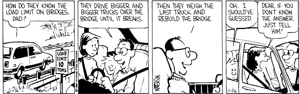

> Released code at work this week which was a huge refactor that had (🤞) no noticeable changes to the existing application. 
- I said that [last week](https://www.builtwith.coffee/blog-posts/2021/08/weeknotes-for-the-week-ending-august-1-2021) then learned, well, there were noticeable changes for the end user, mainly in that the old code gracefully handled 500 errors that should not have been thrown in the first place. It drove good conversation around how to do things better in the future (and an investigation into where/why those 500s even exist), but it was a week where being a developer felt a bit like this:

- I made muffins yesterday morning. That’s the whole story. It was [this recipe](https://www.foodnetwork.com/recipes/classic-deviled-eggs-recipe-1911032) if you want a much longer story. And if you want recipes without long stories, I recommend [Paprika](https://www.paprikaapp.com). Over the years it’s becoming the app with the longest runtime on my devices.
- I’ve been reading [_Bullshit Jobs_](https://en.wikipedia.org/wiki/Bullshit_Jobs). It’s unlikely I’ll finish it before the library demands its digital copy back, but it’s putting words to how I felt about my career as a Quality Assurance Specialist in Biotech. That role, which I fell into by by way of being a technical writer who understood how to file the appropriate paperwork appropriately, falls into the “box tickers” category, or, people who “who create the appearance that something useful is being done when it is not”. I could not better describe how I felt about filing regulatory paperwork that would never be read again. I acknowledge that the long trail of filed paperwork proves useful when something goes awry, and there are plenty of examples where regulatory compliance gets us amazing and reliable results, like the COVID vaccine. But that wasn’t a thing I saw in my day to day work, which is the sentiment the book attempts to put a more scientific eye to.
- There’s one quote in the book that jumped out at me:
> I managed to maneuver my way into a desk with its back to the wall, so I could spend as much time as possible surfing the internet or teaching myself computer programming.

It stood out because I did the same thing at my last biotech job. We had a week where my team was in-between offices, and rather than our usual dedicated bullpen space, we all had to squeeze into a conference room. Which sounds awful, but I’d get in early and grab the head of the conference room table. That seat, with a wall behind me, was the only time I’d ever had a space “to myself” at that job, and I spent the entire week running JavaScript files in Firefox to learn how the `canvas` element works.