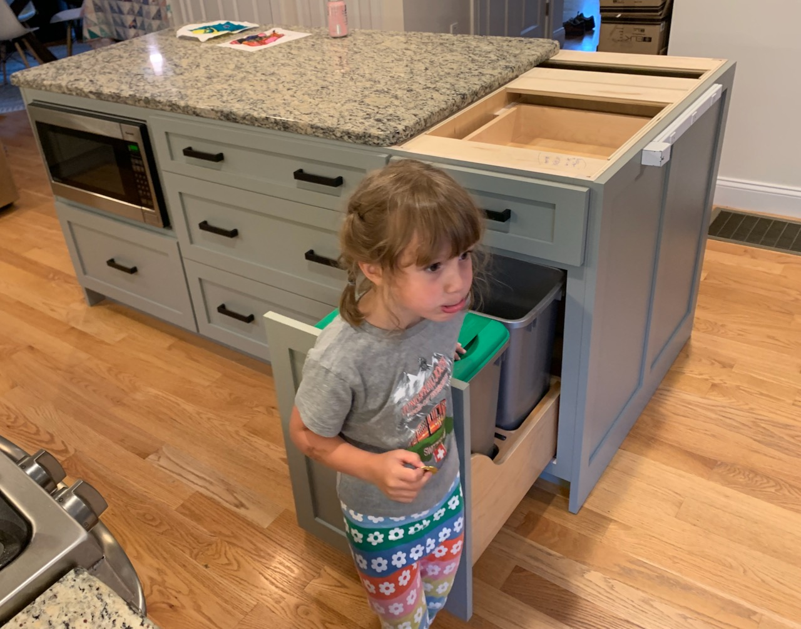

- 🦅🇺🇸🎆. Or not, we’re just bumming around the house. If we’re lucky we’ll see some fireworks from the back deck.
- Our new kitchen cabinets went in this week. There’s so much room now! The finishing touches (sink, hood, counters, tile) are still a few weeks out so it’s exciting but mostly non-functional.

_My daughter checking out the new island, I guess wondering where the old one went to._
- We had some electrical work done in the kitchen as well, and it occurred to me how the piece of paper taped to the inside of our circuit breaker panel is like code comments, most of them are wrong and you can’t trust what they say, but they might help you narrow down what you’re looking for a tiny bit.
- I also learned that electrical code now requires you to have [AFCI circuit breakers](https://www.afcisafety.org/afci/what-is-afci/) which are good because arc faults are _bad_ but I also learned that some household appliances inherently generate arcs (brushed motors, mostly) and those can trip the circuit breaker. Which is why using the “brush roller” feature on our vacuum cleaner would trip a few of the outlets in our house, but not others, but now the entire downstairs is on AFCI breakers so it trips anywhere if we use that feature.
- We watched [The Queen’s Gambit](https://www.netflix.com/title/80234304) this week. I guess everyone else watched it last year? It was really visually interesting, you can play a fun game of “find the chess boards in the set / costume design” while you watch. I enjoyed chess as the narrative frame for a coming of age story, although in my wife’s words, “all I understand is that if you take drugs you can play chess”.

## Album a day
Getting a little lazy with this. On the plus side, though, I realized the other day that the 3.5mm jack on my monitor is a line-out, not a line-in, so listening while at my desk got a lot easier. Why did I ever think it was a line-in?

- July 4: [‎Butterfly 3000 by King Gizzard & The Lizard Wizard](https://music.apple.com/us/album/butterfly-3000/1569279719)
- July 3: [‎On A Friday Evening (Live) by Bill Evans Trio](https://music.apple.com/us/album/on-a-friday-evening-live/1571413349)
- July 2: [‎Home Video by Lucy Dacus](https://music.apple.com/us/album/home-video/1559506368)
- July 1: [‎Below by Beartooth](https://music.apple.com/us/album/below/1555808295)
- June 30: [‎Swimming by Maple Glider](https://music.apple.com/us/album/swimming/1558456316?i=1558456318)
- June 29: [‎Date Night: Chromeo Live! by Chromeo](https://music.apple.com/us/album/date-night-chromeo-live/1566230235)