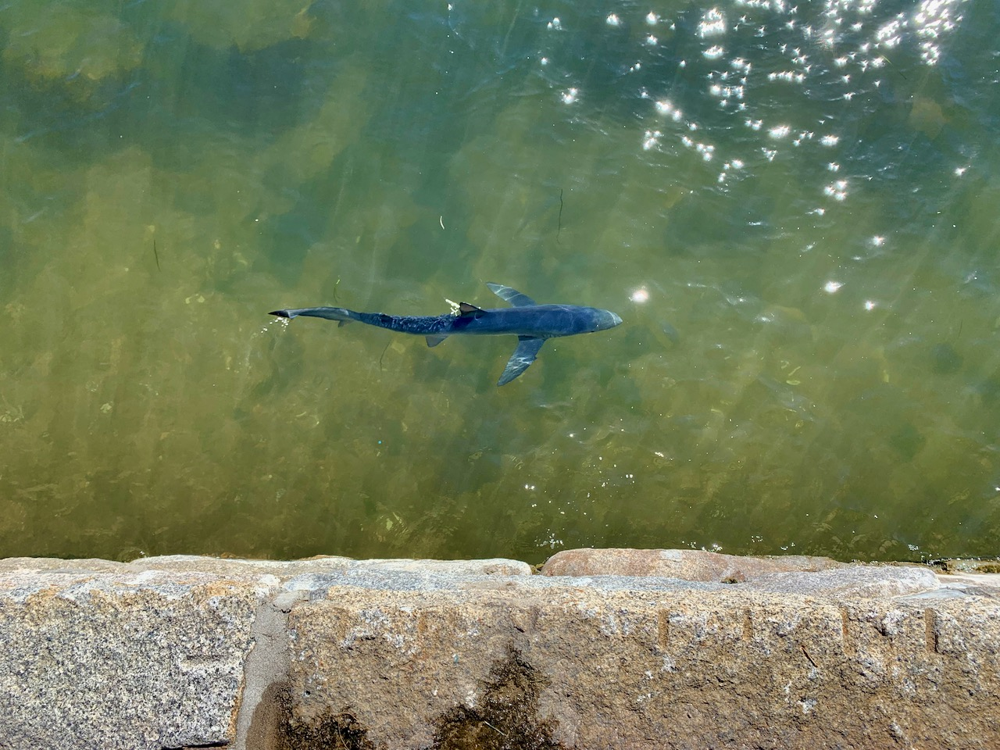

This week, summed up in two short scenes with my daughter.

### Reading is fundamental
_Scene: Local restaurant, on the outdoor patio. A rare family dinner outside the house because the grandparents were visiting before they set off on a cross-country train ride._

👨: What do you want to eat here? 
👧: Hot dog! 
👨: Are hot dogs on the menu? 
👧: I dunno? 
👨: Read the menu and see if you can find hot dogs. 
👧: I can’t read! 
👨: Yes you can, look at the menu and pick out something. 
👧: Pizza! Ice cream! Waffles! 

_Later, outside after dusk. My father and daughter are talking about stars in the sky._

👧: Can I see your phone, I want to know what star that is. 
👨: _Opens [Sky Guide](https://apps.apple.com/us/app/sky-guide/id576588894), hands over phone._ 
👧: Oh, it’s Jupiter. 
👨: How do you know? 
👧: _Points at screen._ Ju-pi-ter. It says Jupiter. 
👨: _Picks up daughter by shoulders, turns her 45 degrees._ 
👨: What about that one over there? 
👧: Venus! 
👨: So you... can read? 
👧: Noooooooooooooooo

### 🦈

_Scene: at [Stage Fort Park](https://essexheritage.org/attractions/stage-fort-park-gloucester-visitor-center), down on the "boardwalk" looking at the ocean._

👧: Look, a shark! 
👨: I don’t think there are sharks here. 
👧: It’s right there! 
👨: It’s probably just a ro… oh it is a shark. 

### etc
- I’ve used [Magnet](https://magnet.crowdcafe.com) for window management on MacOS for a long time, but it turns out there’s a free option called [Rectangle](https://github.com/rxhanson/Rectangle) that works just as well, and you can install it via [Homebrew](https://brew.sh), which is extra great because I have zero interest in using Mac App store apps on my work Mac.
- I went too long before getting my coffee this morning (we picked up breakfast on the car ride over to aforementioned shark park), and the coffee was weak compared to what I make at home. Took a while to recover. Maybe I should have gotten `onlyfunctionalwith.coffee` instead.