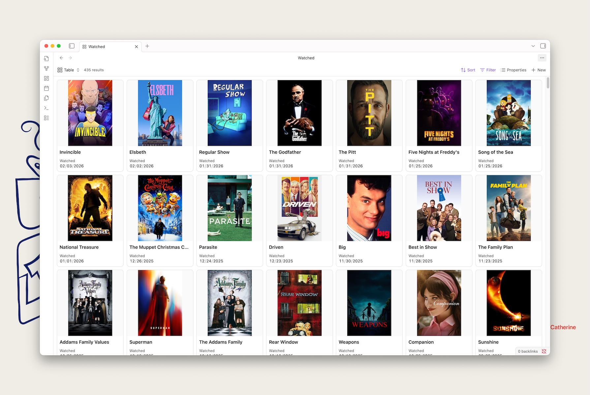

**TL;DR:** the page is at [/stream](/stream).

I wanted a simple thing: one place to show all of the media I consume. Mainly as a record for myself, as I struggle with object permanence in a world gone digital.
<aside data-emoji="📚">I still buy physical books when possible, more to support our local bookstore than to save on a shelf, but also because it‘s the only media you can hand to someone these days without having to worry if they have a way to play it.</aside>

For me that’s reading books, watching movies/tv, noting favorite songs, and playing video games. I wanted a way to see this on my own PC but also here on my website, with some level of ease for automating collection, which meant looking at third party services to store the data, then pulling from those services to save the data in Markdown.

## Research
The first thing I recognized was I needed to use services which did two things:
1. Automated the process of connecting media to a central database of information. I was manually adding Markdown files for books I read and it was annoying. I want someone else to make a nice easy UI for that part of the process.
2. Expose an API to make retrieving information from them to store as Markdown simple.

For #2 I considered a hierarchy of usefulness when evaluating services:
1. Best would be an open and documented API.
2. Second best an RSS feed that has all the data I wanted to save in it.
3. Third best a way to export my data (ideally automated) in JSON or CSV to be passed to a script that could convert to Markdown.
3. Last would be a public page that can be scraped for data.

## Services
Here’s a rundown of where I landed on the services that provided the UI for collecting data. A few I was already using, some I had to find new services to fit the criteria noted above.

### Books
I had previously done a mix of saving books I read as Markdown manually and using [Hardcover](https://hardcover.app). The great thing about Hardcover is it has an API! It was, in fact, created because Goodreads took their API down. The API is still in flux and the book data is ok at best, but there aren’t many alternatives and it works well enough for me.

### Movies (and TV)
I was using [Letterboxd](https://letterboxd.com) to save what movies I watched. I mostly like Letterboxd for the social features and shit-takes as reviews. Letterboxd offers a bulk export feature, but no API. Letterboxd also _only_ handles movies, so I exported all my data and tried [Simkl](https://simkl.com/) which does have an API, but I found the UI to be… lacking. Searching TVs and movies is a surprisingly complicated experience, and they just haven't quite pinned it down yet.

I ended up landing on [Trakt](https://trakt.tv/) which integrates well with a lot of media players, does movies and TV, and has an acceptable interface. They have an API, although it also required connecting to [TMDB](https://www.themoviedb.org) to pull images.

<aside data-emoji="📺">

If you use [Infuse](https://firecore.com) for local media, they have a [Trakt](https://support.firecore.com/hc/en-us/articles/4405098078743-Trakt-Sync) integration!

</aside>

### Music
I’ve inconsistently used [last.fm](https://www.last.fm/) for music tracking, and it has an API. I set it up to only pull loved songs, as I scrobble a _lot_ of music. I use [Sleeve 3](https://replay.software/sleeve) on my Mac to make it easier to do from Apple Music, although I’ve also been trying out [Ampcast](https://github.com/rekkyrosso/ampcast) to get Apple Music and my [Plex Amp music](https://www.plex.tv/plexamp/) in one place that correctly sends data to last.fm.

<aside data-emoji="🎵">

I was using [NepTunes](https://apps.apple.com/us/app/neptunes-for-itunes-spotify/id1006739057?mt=12) for scrobbling as Sleeve 2 was broken at the release of Tahoe. Sleeve has a slightly nicer UI, and works again with the release of version 3.

</aside>

### Video Games
This is probably the clunkiest integration, currently. [Infinite Backlog](https://infinitebacklog.net) is great at syncing with my Steam and PlayStation activity, but has no API. It does have an export feature, and references an [IGDB](https://www.igdb.com) ID for each game, so you can export the data and then hit the IGDB API to get richer details.

## Process
I used two tools extensively:
1. [Kagi’s Assistant](https://kagi.com/assistant) to do AI assisted web searches for services that had APIs. It does an _amazing_ job of getting the information I needed, from comparing similar services, to digging into the APIs or finding libraries and scraping options that might work.
2. Claude Code to write all the code. I manually wrote none when adding this feature. Putting together scripts to pull from documented APIs and formatting JSON to Markdown + YAML are two things I find LLM tools to be great at, so, go nuts Claude.

## You said it works locally too?
Yeah! Once you’ve got all this data as Markdown, you can use [Obsidian Bases](https://help.obsidian.md/bases) to view it. As a simple example, here is all my data from Trakt as a base:

This way in the future if all these services enshittify themselves, or you want to add data they don’t support, you’ve got local backups.

<aside data-emoji="💩">

By the way, one of the books I read this year was [Enshittification](https://hardcover.app/books/enshittification).

</aside>